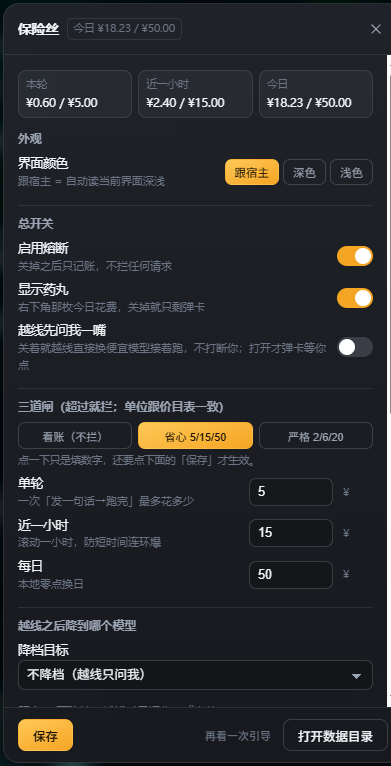

# 保险丝 · dsh-fuse

> 挂机跑了一夜，早上发现烧掉四十块。

*A cost fuse for DeepSeek Harness: three hard spend caps (per turn / per hour / per day). When one trips it degrades the model first, asks you second, and only then stops the request — every decision is logged.*

## 这是什么

这个插件不让你少干活。它只做一件事：在你快烧穿的时候，把闸真的拉下来——先降档、再问人、最后才停。

装进 DSH（DeepSeek Harness）之后，右下角会多一枚小药丸，显示今天花了多少。越过你设的线，它不会只变个颜色提醒你，而是拦住**下一发请求**。

市面上的「花费显示」已经够多了——它们把账算给你看，然后继续跑。区别就在最后一格：**看到 ¥48.6 之后，它还会让你再发一发。**



*点右下角的药丸打开面板：上面是今日花费，中间改三道闸、降档目标和价目表，下面是最近的拦截记录。*

## 怎么装

**插件市场**：Plugins → 插件市场，搜「保险丝 / dsh-fuse」，一键装，装完重启一次 DSH。

**命令行**（本机装了 `dsh` CLI 的情况；桌面端用 `--profile desktop`，`dsh web` 用 `--profile web`）：

```bash
dsh plugin --profile desktop add github:你的用户名/dsh-fuse
```

**从本地目录装**（改代码时用）：

```bash
# 在 profile 目录（一般是 ~/.dsh/profiles/desktop）
pnpm add file:D:/你的路径/dsh-fuse
# 再把 "dsh-fuse" 加进这个目录 package.json 的 dsh.profile.bundles
```

装完**重启一次 DSH**——插件两半都是启动时读进内存的，重启前看不到药丸。

> 需要宿主 `>=0.2.0-rc.2 <0.3.0`、Node `>=20`。`lib/client.js` 是构建产物，仓库里已经带好，从 GitHub 装不需要在本机跑构建。

## 它做什么

**三道闸，默认值就不容易误伤：**

| 闸 | 默认 | 管的是什么 |
|---|---|---|
| 单轮 | ¥5 | 一个回合里反复试错、长工具链连环烧 |
| 近一小时 | ¥15 | 短时间连开几个会话、手滑狂点重试 |
| 今日 | ¥50 | 挂机跑一整夜 |

超过任意一道就触发。**默认值是留给「不想一觉醒来看到四十块」的人的**，想更松就改，数字随你。

**越线之后，按这个顺序处理：**

1. 有便宜型号可换：直接在**下一步**换过去继续跑，不打断你。宿主不允许中途改「已经发出去的那一发」，所以换模型从下一步生效，会话里会出现一行 `[model changed: …]` 告诉你换到哪了；
2. 没填降档目标也没关系：插件会自己从你用过的型号里挑一个「输入和输出都更便宜」的换过去；
3. **只换当前线路上真有的型号**：换之前会先问宿主「这条线路提供哪些模型」，不在名单上的型号一律不换（宁可放行），因为换过去会让下一步直接失败、整轮任务跟着崩。第三方网关（pi-ai 之类）通常不上报型号清单，这时退一步用流水当证据——**这个型号只要在这条线路上真跑过一次，就允许换回去**；从没跑过的，仍然只放行。面板的降档下拉也是按这个名单来的，读不到名单时会提示你手动确认；
4. 实在换不了（一个更便宜的都挑不出来、或目标不可用）：整轮放行，只记一笔账，**不会把请求挂死**；
5. 想让它越线时停下来问你？面板里打开「越线先问我一嘴」，才会弹卡——默认是关的，因为挂起请求会把整轮任务停在原地。

| 按钮（仅「越线先问我一嘴」打开时出现） | 会发生什么 |
|---|---|
| 降档继续 | 从下一步换成目标模型，本轮不再问 |
| 放行一次 | 这一轮整个放过去，下一轮重新算 |
| 停止本轮 | 请求不发，你刚发的那句话回到输入框 |

**记账用宿主给的数**：只读 `assistant/message` 里已经归一化好的 usage，按价目表折算，不猜 token。

**换供应商也算得清**：同一个模型名，官方直充和中转站可能差好几倍价。面板「高级」里可以给每个供应商填一个倍率（中转站打三折就填 `0.3`），价格按「供应商自己的价 → 全局价目 → 全局价 × 倍率」依次解析。**根本不知道单价**也行：直接按 token 卡（每天多少万 token），这套闸完全不依赖价目表。

**每一笔都有据可查**：默认在 `~/.dsh/dsh-fuse/`（面板里可以改到别的盘），两个 JSONL，只增不改，删掉即清空。

- `ledger-YYYY-MM-DD.jsonl`：逐笔用量与金额
- `audit-YYYY-MM.jsonl`：每次拦截、放行、降档、停止

流水写在文件里，进程退出不会消失；重开 DSH 时，今天的账会接着算。

## 它刻意不做什么

- **不掐正在跑的请求**：拦的是下一发。真要在流中间断，只能挂到更底层的流式钩子上，代价是跟别的插件互相拖累。
- **不猜 token、不读对话**：只看宿主报的 usage 数字，不碰你的消息内容。
- **不联网**：不发任何请求、不上传任何东西（`permissions.network: []`），也不需要 key。
- **不冒充账单**：内置价目是参考价，第三方网关、折扣、企业版对不上，要自己填（或者改用 token 闸）。
- **不做「每发都提醒」的唠叨**：默认值平时根本碰不到，碰到就是真出事。
- **不做代理、不做限流、不管别的应用**：它只拦 DSH 里发出的模型请求。

## 配置

点药丸打开面板，能改：总开关、药丸显隐、越线是否问你、界面颜色（跟宿主 / 深色 / 浅色）、三道金额闸、降档目标（下拉，里面有「不降档」和你用过的型号，选「其他…」才手填）、价目表，以及看一眼最近的拦截；「高级」里收着供应商倍率、按 token 卡、数据目录。面板底部的「复制数据目录」把流水所在的路径放进剪贴板，粘到资源管理器地址栏就能进去（插件自己不起子进程，也不碰系统文件管理器）。

面板之外的东西（币种符号、静默时长、超时秒数、provider）直接改文件：

`~/.dsh/dsh-fuse/config.json`（设置了 `DSH_HOME` 就跟着它走）

```jsonc
{
  "enabled": true,
  "currency": "¥",               // 只换符号，不做汇率换算
  "caps": { "turn": 5, "hour": 15, "day": 50 },
  "capsTokens": { "turn": 0, "hour": 0, "day": 0 },  // 单位：万 token；0 = 这一道关掉
  "appearance": "auto",          // auto / dark / light
  "providers": {},               // { "openrouter": { "multiplier": 0.3 } }
  "warnRatio": 0.6,              // 到日上限的 60% 药丸变黄
  "autoDegrade": true,           // 越线就自己换便宜模型接着跑
  "askOnTrip": false,            // true = 越线弹卡问你；默认 false，绝不挂起请求
  "degradeTo": { "provider": "", "model": "" },  // model 留空 = 自动挑一个更便宜的
  "decisionTimeoutSec": 30,      // 弹卡等多久
  "clientSilenceSec": 45,        // 界面多久没动静算「没人看」
  "silentMinutes": 60,           // 点过「停止」后，这个会话安静多久
  "pill": true,
  "prices": {}                   // 覆盖价目表，单位：元 / 百万 token
}
```

- `providers` 里可以给供应商单独特价：`{ "中转站A": { "multiplier": 0.3, "prices": { "deepseek-chat": { "input": 1, "cacheRead": 0.1, "output": 2 } } } }`；只填倍率也够用。
- `capsTokens` 的优先级和金额闸一样：先到先拦，两个都开着就看谁先超。
- 面板里保存**立即生效**；手改文件要**重启 DSH**。
- `degradeTo.model` 填一个你这条线路上真实存在的便宜型号（比如 `deepseek-chat`）。留空时，卡上中间那颗按钮会变成「继续本轮」；没人看界面时则整轮放行——插件不猜你的线路里哪个型号更便宜。
- 价目表支持前缀匹配（`deepseek-chat-0915` 会认 `deepseek-chat`），`*` 是兜底；都匹配不上时按内置兜底价，宁可粗一点，也不把账记成 0。

## 关闭与卸载

**临时关掉拦截**（只记账、不拦你，药丸照旧显示花了多少）：面板里关「启用熔断」，或者 `"enabled": false`。

**只隐藏药丸**（弹卡照旧）：面板里关「显示药丸」，或者 `"pill": false`。

**彻底卸载**：

```bash
dsh plugin remove dsh-fuse
```

数据都在 `~/.dsh/dsh-fuse/`（配置、流水、审计）。卸载不会替你删，确认不要了直接删目录，等于清空。

## 自检

装完先看三处：

1. 右下角有没有药丸，数字是不是今天的账；
2. `/fuse status` —— 今日 / 近一小时 / 本轮各花了多少、上限多少；
3. 点药丸，面板底部「最近的拦截」有没有内容（没拦过是好事，显示为空）。

没有图形界面也能用：`/fuse status` 看账，`/fuse config` 看设置，`/fuse audit` 看当前挂起的熔断。

从源码跑测试：

```bash
npm test                       # 构建 + 离线自检
node scripts/host-smoke.mjs    # 假宿主冒烟，不用装进 DSH
```

## 许可

MIT
